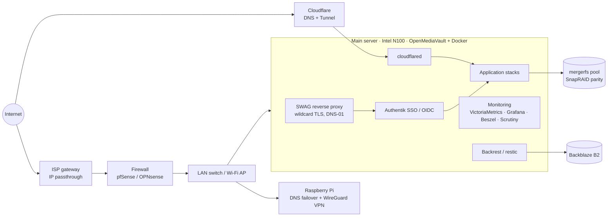

# Homelab

Docker Compose stacks and operating notes for a self-hosted home server running 50+ containers. This repo documents **what runs, how it's configured, and how it's operated**: networking, SSO, monitoring, backups, and the incidents that shaped it.

> Public, sanitized copy of a private working repo. Domains are replaced with `example.com`, and every secret is an environment-variable reference. Real values live in git-ignored `.env` files on the server.

---

## Architecture

## Hardware

| Device | Role | Notes |
|---|---|---|
| Beelink Mini S12 Pro | Main server | Intel N100, 16GB RAM, OpenMediaVault, Docker |
| └ NVMe SSD | OS / Docker | External fan added (thermals ~85°C → ~52°C) |
| └ USB DAS | Data array | mergerfs pool + SnapRAID parity |
| Raspberry Pi Zero | Secondary DNS, VPN | AdGuard Home (failover), PiVPN/WireGuard |
| Lanner FW-7551 | Firewall / router | Repurposed SD-WAN appliance; DHCP, NAT, firewall rules |
| Managed switch + Wi-Fi AP | LAN | AP mode, static non-DFS 5GHz channel |
| Windows PC (RTX 3070) | GPU offload | Remote whisper.cpp transcription over the LAN |

## Network & access model

- **LAN:** single `/24`, DHCP pool `.100–.199`, static mappings for infrastructure outside the pool
- **DNS:** AdGuard Home on the server and the Pi for network-wide filtering with failover
- **Admin and single-user apps** → reachable only over **WireGuard VPN**
- **Shared or public apps** → **SWAG** reverse proxy (wildcard cert via Cloudflare DNS-01) or **Cloudflare Tunnel**, so no inbound ports are opened for tunneled services
- **SSO** → **Authentik (OIDC)** in front of shared apps, with access restricted by group membership

## Conventions

| What | Where |
|---|---|
| Compose stacks | `/compose/<stack>/<stack>.yml` |
| Stack secrets | `/compose/<stack>/<stack>.env` (git-ignored) |
| App data | `/appdata/<stack>/` |
| App config | `/config/<stack>/` |
| Data array | `/srv/mergerfs/Data/` |

- **PUID/PGID:** `1000` / `100` · **TZ:** `America/New_York`
- **Email:** SMTP relay with one dedicated SMTP user per service, port 465 (implicit TLS)

## Secrets handling

- Every secret in a compose file is a `${VAR}` reference; real values live in that stack's `.env`.
- Required secrets use `${VAR:?message}`, so a stack refuses to start if a value is missing.
- `.gitignore` excludes `*.env`; `*.env.example` templates are allowed.
- **CI runs gitleaks** on every push and pull request to catch committed secrets.
- Cloud credentials are scoped per purpose (for example, one Backblaze B2 application key per bucket).

## Workflow

Stacks are managed with the OpenMediaVault Compose plugin, which stores stack definitions and regenerates the files in `/compose`. Changes flow one way:

**OMV UI → `/compose` files → git → GitHub**

1. Edit the stack in OMV, save, and redeploy. OMV commits locally on save.
2. Review and push over SSH (`git log origin/main..HEAD`, optionally amend the message, `git push`).
3. Files in `/compose` are never edited by hand. To roll back, restore the previous version from git into OMV and redeploy.

---

## Stacks

Access: 🌐 public (SWAG/Tunnel, SSO where supported) · 🔒 LAN/VPN only

| Stack | What it does | Access |
|---|---|---|
| [authentik](stacks/authentik) | SSO / OIDC identity provider | 🌐 |
| [swag](stacks/swag) | Reverse proxy, wildcard TLS cert | 🌐 |
| [cloudflared](stacks/cloudflared) | Cloudflare Tunnel for public services | — |
| [adguard](stacks/adguard) | DNS filtering (primary/replica with the Pi) | 🔒 |
| [monitoring](stacks/monitoring) | VictoriaMetrics, vmagent, cAdvisor, node-exporter, Grafana | 🔒 |
| [beszel](stacks/beszel) | Lightweight system + SMART monitoring | 🔒 |
| [backrest](stacks/backrest) | restic backups → local + Backblaze B2 | 🔒 |
| [vaultwarden](stacks/vaultwarden) | Self-hosted Bitwarden-compatible server | 🌐 |
| [nextcloud](stacks/nextcloud) | Files (custom image), MariaDB, Redis, OIDC login | 🌐 |
| [immich](stacks/immich) | Photo library + public share proxy | 🌐 |
| [paperless-ngx](stacks/paperless-ngx) | Document management | 🔒 |
| [frigate](stacks/frigate) | NVR, OpenVINO object detection on the iGPU | 🔒 |
| [Home Assistant](stacks/Home%20Assistant) | Home automation + ESPHome | 🔒 |
| [Plex](stacks/Plex) / [Jellyfin](stacks/Jellyfin) | Media servers with hardware transcoding | 🌐 / 🔒 |
| [tunarr](stacks/tunarr) | Custom live channels (VA-API) | 🔒 |
| [Book](stacks/Book) | Audiobookshelf, Grimmory | 🌐 |
| [bookbridge](stacks/bookbridge) | Reading-progress sync between book apps | 🔒 |
| [mealie](stacks/mealie) | Recipes and meal planning | 🌐 |
| [sparkyfitness](stacks/sparkyfitness) | Fitness / nutrition tracker | 🌐 |
| [actual](stacks/actual) | Budgeting | 🔒 |
| [joplin](stacks/joplin) | Notes sync server | 🔒 |
| [lubelogger](stacks/lubelogger) | Vehicle maintenance log | 🔒 |
| [wikijs](stacks/wikijs) | Wiki | 🔒 |
| [Homepage](stacks/Homepage) | Dashboard | 🔒 |
| [Octoprint](stacks/Octoprint) | 3D printer control | 🔒 |
| [halcyon-video](stacks/halcyon-video) | Jellyfin client, built from source | 🔒 |
| [wizarr](stacks/wizarr) | Media server user onboarding | 🌐 |

## Storage & backups

- **Array:** mergerfs pool with SnapRAID parity; nightly sync/scrub via `snapraid-aio` with email alerts
- **Write-heavy containers** (for example, Frigate) are stopped during SnapRAID sync to avoid parity conflicts
- **Drive health:** Scrutiny + Beszel SMART monitoring
- **Off-site:** Backrest (restic, encrypted) → Backblaze B2

---

## Incident log

Short write-ups of problems found and fixed on this server.

| Incident | Root cause | Fix |
|---|---|---|
| Data pool unmounted for ~3 days; ~230GB written to the boot SSD | USB DAS dropouts and GPT corruption on one array disk; containers kept writing to the empty mount path on the boot drive | Repaired the partition table, remounted the pool, cleaned stray data off the boot drive |
| SnapRAID sync repeatedly killed by the kernel OOM killer | ~50 containers with only ~1GB of swap; the nightly job ran during a busy window | Moved the job to 3am and added an 8GB swapfile for headroom |
| Array disk flagged as likely to fail | SMART log errors; monitoring estimated a 41% one-year failure probability | Replaced the drive, copied data with rsync, swapped it into the mergerfs pool and SnapRAID config |
| SnapRAID "cannot modify data disk during sync" errors | Frigate writes continuously to a data disk | Added Frigate to the services stopped during sync |
| New stacks failed to start (no free address pools) | Docker's default network address pools exhausted | Defined `default-address-pools` in `daemon.json` |
| NVMe SSD running at ~85°C | Passive cooling in a small chassis | Added external fan; temps dropped to ~52°C |

## Roadmap

- [ ] Manage Backblaze B2 buckets and keys with **Terraform**
- [ ] Recovery runbooks: bare-metal rebuild from B2, failed-drive replacement, DNS failover
- [ ] Pin image tags on stateful services (databases)
